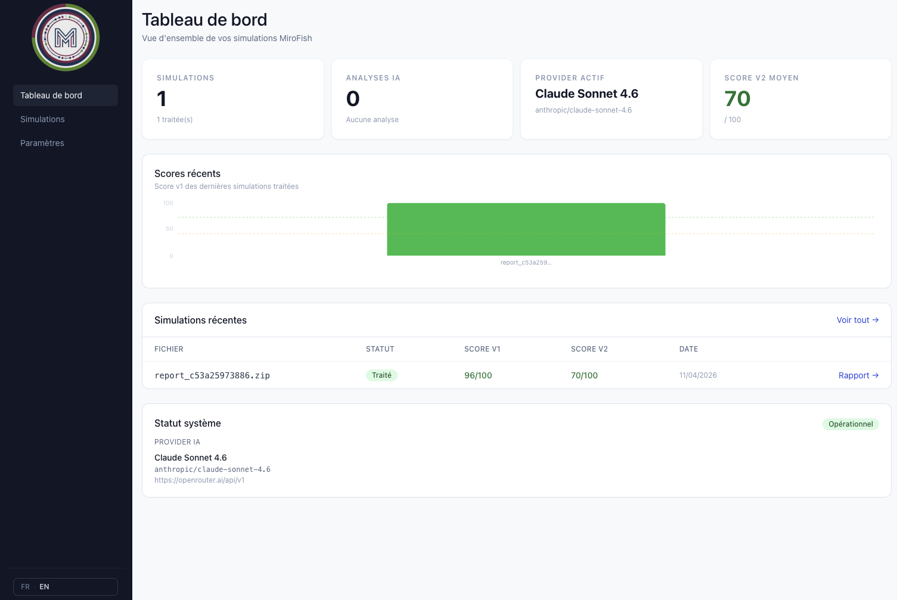
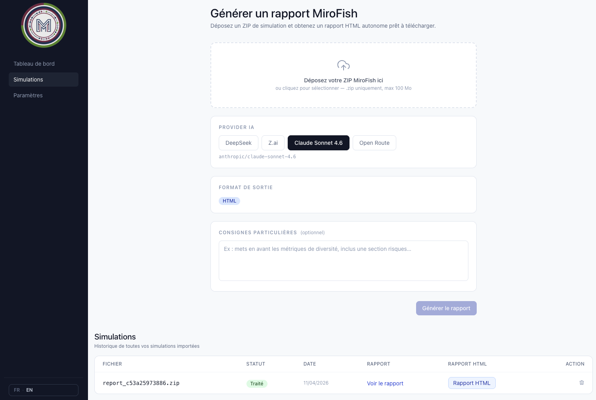

# MiroResult

> **FR** — MiroResult est un projet communautaire indépendant permettant de lire, visualiser et valoriser des outputs de simulation [MiroFish](https://github.com/666ghj/MiroFish). Il transforme des données brutes de simulation multi-agents en rapports décisionnels visuels, générés par IA.
>
> **EN** — MiroResult is an independent community project for reading, visualizing and enhancing [MiroFish](https://github.com/666ghj/MiroFish) simulation outputs. It transforms raw multi-agent simulation data into AI-generated visual decision reports.

> [!IMPORTANT]
> **FR** — MiroResult n’est pas un composant officiel de MiroFish. Il n’a pas été audité, validé ni certifié compatible par les mainteneurs de MiroFish.
>
> **EN** — MiroResult is not an official MiroFish component. It has not been audited, validated or compatibility-certified by the MiroFish maintainers.

> [!WARNING]
> **FR** — La version officielle actuelle de MiroFish permet le téléchargement de rapports Markdown, mais ne fournit pas de workflow intégré et stable d’export ZIP. Le fichier ZIP importé dans MiroResult doit donc être préparé par l’utilisateur selon la structure attendue.
>
> **EN** — The current official MiroFish version provides Markdown report downloads, but does not expose a built-in stable ZIP export workflow. The ZIP archive imported into MiroResult must therefore be prepared by the user according to the expected structure.

---

## Comment ça fonctionne / How it works

~~~
MiroFish simulation outputs
      │
      ▼
User-prepared ZIP archive
      │
      ▼
 MiroResult import
      │
      ▼
AI analysis / Analyse IA
(double-pass analysis + self-critique)
      │
      ▼
Visual HTML report / Rapport HTML visuel
      │
      ▼
Iterative chat to refine the report
Chat itératif pour affiner le rapport
~~~

**FR**

1. Lancer une simulation dans [MiroFish](https://github.com/666ghj/MiroFish).
2. Récupérer les fichiers de sortie disponibles.
3. Préparer manuellement une archive ZIP compatible avec MiroResult.
4. Importer cette archive ZIP dans MiroResult.
5. L’IA analyse les données en deux passes : analyse initiale puis auto-critique.
6. Un rapport HTML exploitable est généré, avec graphiques SVG inline.
7. Le chat intégré permet d’itérer et d’affiner le rapport.

**EN**

1. Run a simulation in [MiroFish](https://github.com/666ghj/MiroFish).
2. Collect the available output files.
3. Manually prepare a ZIP archive compatible with MiroResult.
4. Import this ZIP archive into MiroResult.
5. The AI analyses the data in two passes: initial analysis and self-critique.
6. A ready-to-use HTML report is generated, with inline SVG charts.
7. The built-in chat can be used to iterate and refine the report.

---

## Statut du projet / Project Status

**FR**

MiroResult est une expérimentation communautaire indépendante. Le projet est fonctionnel, mais encore perfectible. Il doit être considéré comme un outil complémentaire non officiel, destiné à explorer une manière visuelle et assistée par IA d’exploiter des résultats de simulation.

**EN**

MiroResult is an independent community experiment. The project is functional, but still evolving. It should be considered an unofficial companion tool designed to explore an AI-assisted visual way of working with simulation results.

---

## Compatibilité / Compatibility

**FR**

MiroResult a été conçu à partir du format d’outputs MiroFish disponible au moment du développement.

Cependant, comme MiroFish ne fournit pas actuellement de schéma ZIP officiel et stable, la compatibilité peut être rompue si la structure des outputs MiroFish évolue.

Il est recommandé d’indiquer, pour chaque version de MiroResult, les versions ou commits MiroFish testés.

**EN**

MiroResult was designed based on the MiroFish output format available at the time of development.

However, because MiroFish does not currently expose an official stable ZIP schema, compatibility may break if the MiroFish output structure changes.

It is recommended to document, for each MiroResult version, the MiroFish versions or commits that have been tested.

### Versions testées / Tested versions

**FR**

La compatibilité exacte avec un commit ou une version MiroFish spécifique n’a pas encore été formellement documentée.  
MiroResult doit donc être considéré comme expérimental jusqu’à ce que des versions ou commits testés soient listés ici.

**EN**

Exact compatibility with a specific MiroFish commit or version has not yet been formally documented.  
MiroResult should therefore be considered experimental until tested versions or commits are listed here.

---

## Structure ZIP attendue / Expected ZIP Structure

> [!NOTE]
> **FR** — Cette structure doit être adaptée à vos outputs réels. MiroResult ne dépend pas d’un export ZIP officiel de MiroFish.
>
> **EN** — This structure must be adapted to your actual outputs. MiroResult does not rely on an official MiroFish ZIP export.

**FR**

MiroResult attend une archive ZIP contenant les fichiers de sortie nécessaires à l’analyse d’une simulation. Le ZIP doit être préparé par l’utilisateur à partir des fichiers générés par MiroFish.

Exemple de structure possible :

~~~text
simulation.zip
├── metadata.json
├── results.json
├── agents/
│   └── ...
├── rounds/
│   └── ...
├── reports/
│   └── ...
└── assets/
    └── ...
~~~

**EN**

MiroResult expects a ZIP archive containing the output files required to analyse a simulation. The ZIP archive must be prepared by the user from files generated by MiroFish.

Possible example structure:

~~~text
simulation.zip
├── metadata.json
├── results.json
├── agents/
│   └── ...
├── rounds/
│   └── ...
├── reports/
│   └── ...
└── assets/
    └── ...
~~~

> [!CAUTION]
> **FR** — Ne placez jamais de clés API, secrets, tokens ou identifiants sensibles dans l’archive ZIP.
>
> **EN** — Never include API keys, secrets, tokens or sensitive credentials inside the ZIP archive.

---

## Données et confidentialité / Data and Privacy

**FR**

Les fichiers de simulation importés sont utilisés par MiroResult pour générer des rapports visuels et des analyses assistées par IA.

Avant d’importer une archive, l’utilisateur doit vérifier son contenu et s’assurer qu’elle ne contient pas d’informations confidentielles, de clés API ou de données qu’il ne souhaite pas transmettre à un provider IA.

Selon le provider configuré, certaines données issues de la simulation peuvent être envoyées à un service externe compatible OpenAI afin de générer l’analyse.

**EN**

Imported simulation files are used by MiroResult to generate visual reports and AI-assisted analyses.

Before importing an archive, users should review its content and make sure it does not contain confidential information, API keys or data they do not want to send to an AI provider.

Depending on the configured provider, some simulation data may be sent to an external OpenAI-compatible service to generate the analysis.

---

## Configuration IA / AI Configuration

MiroResult supporte tout provider compatible OpenAI : OpenRouter, Mistral, Groq, Anthropic, DeepSeek, Z.ai, etc.

*MiroResult supports any OpenAI-compatible provider: OpenRouter, Mistral, Groq, Anthropic, DeepSeek, Z.ai, etc.*

Chaque utilisateur configure ses propres clés API directement dans l’interface.

*Each user configures their own API keys directly in the interface.*

Dans l’interface, rendez-vous dans **Paramètres → Providers IA** pour configurer :

*In the app, go to **Settings → AI Providers** to configure:*

- Nom du provider / Provider name
- URL de base / Base URL, ex: `https://api.z.ai/api/paas/v4`
- Clé API / API key
- Modèle / Model, ex: `claude-sonnet-4-6`, `glm-4.7`, `deepseek-chat`

> [!IMPORTANT]
> **FR** — Les clés API ne doivent jamais être placées dans une archive ZIP importée.
>
> **EN** — API keys must never be placed inside an imported ZIP archive.

> [!NOTE]
> **FR** — Les clés API sont configurées par l’utilisateur dans l’application et ne sont pas destinées à être exposées au frontend.
>
> **EN** — API keys are configured by the user in the application and are not intended to be exposed to the frontend.

---

## Stack

| Layer | Technologies |
|---|---|
| Frontend | React 18, TypeScript, Tailwind CSS, React Router v6, Zustand, Axios |
| Backend | Express, TypeScript, Prisma, SQLite, JWT |

---

## Démarrage / Getting Started

### Prérequis / Prerequisites

- Node.js 18+
- npm
- Une simulation MiroFish existante
- Une archive ZIP préparée manuellement à partir des outputs disponibles

- Node.js 18+
- npm
- An existing MiroFish simulation
- A manually prepared ZIP archive based on the available outputs

### Installation

~~~bash
# Cloner le dépôt / Clone the repo
git clone https://github.com/CyrilDEVIA/MiroResult.git
cd MiroResult

# Installer les dépendances / Install dependencies
npm install

# Démarrer en développement / Start in development
npm run dev
~~~

Frontend : `http://localhost:9903`  
API : `http://localhost:9904`

---

## Fonctionnalités / Features

- Import d’archives ZIP préparées par l’utilisateur à partir d’outputs MiroFish
- Analyse IA avec double passe critique : analyse + auto-critique
- Rapport HTML visuel généré par le LLM
- Graphiques SVG inline
- Chat intégré pour itérer et affiner le rapport
- Historique et comparaison de rapports
- Multi-providers IA configurables par utilisateur
- Authentification JWT

- Import of user-prepared ZIP archives based on MiroFish outputs
- AI analysis with a two-pass process: analysis + self-critique
- Visual HTML report generated by the LLM
- Inline SVG charts
- Built-in chat to iterate and refine the report
- Report history and comparison
- Configurable multi-provider AI support
- JWT authentication

---

## Limites connues / Known Limitations

**FR**

- MiroResult n’est pas un outil officiel MiroFish.
- Aucun schéma ZIP officiel MiroFish n’est actuellement garanti.
- La compatibilité dépend de la structure réelle des outputs utilisés.
- Les rapports générés par IA doivent être relus et validés par l’utilisateur.
- La qualité des résultats dépend du modèle IA choisi et des données importées.

**EN**

- MiroResult is not an official MiroFish tool.
- No official MiroFish ZIP schema is currently guaranteed.
- Compatibility depends on the actual structure of the imported outputs.
- AI-generated reports must be reviewed and validated by the user.
- Result quality depends on the selected AI model and imported data.

---

## Contribuer / Contributing

**FR**

MiroResult est un projet open source, fonctionnel mais perfectible. Si vous utilisez MiroFish et souhaitez améliorer cet outil, les contributions sont les bienvenues : correction de bugs, amélioration de l’interface, documentation, support multilingue ou nouvelles fonctionnalités.

Axes d’amélioration identifiés :

- Esthétique et ergonomie de l’interface
- Documentation de la structure ZIP attendue
- Documentation des versions ou commits MiroFish testés
- Support multilingue
- Qualité et richesse des rapports générés
- Tests automatisés
- Packaging et déploiement simplifiés

**EN**

MiroResult is an open source project: functional, but with room to grow. If you use MiroFish and want to improve this tool, contributions are welcome: bug fixes, UI improvements, documentation, multilingual support or new features.

Identified improvement areas:

- UI aesthetics and ergonomics
- Documentation of the expected ZIP structure
- Documentation of tested MiroFish versions or commits
- Multilingual support
- Quality and richness of generated reports
- Automated tests
- Simplified packaging and deployment

~~~bash
# Fork le dépôt, puis :
git checkout -b feature/ma-contribution
git commit -m "feat: ma contribution"
git push origin feature/ma-contribution
# Ouvre une Pull Request
~~~

---

## Conventions

~~~text
src/
├── features/{feature}/     # Pages et logique métier
│   └── NomPage.tsx
├── components/
│   ├── ui/                 # Composants réutilisables
│   └── common/             # Composants génériques
~~~

- Zéro `.jsx` / `.js` dans `src/` — uniquement `.tsx` et `.ts`
- TypeScript strict, zéro `any`
- Zod sur toutes les routes API

---

## Avant déploiement / Before Deployment

~~~bash
# 1. Copier et remplir les variables d'environnement
#    Copy and fill environment variables
cp api/.env.example api/.env
cp frontend/.env.example frontend/.env

# 2. Éditer les fichiers .env avec vos valeurs
#    Edit the .env files with your values
nano api/.env
nano frontend/.env
~~~

> [!CAUTION]
> **FR** — Ne committez jamais vos fichiers `.env`, clés API, tokens ou secrets.
>
> **EN** — Never commit your `.env` files, API keys, tokens or secrets.

---

## Lien / Related

- [MiroFish](https://github.com/666ghj/MiroFish) — simulateur multi-agents dont certains outputs peuvent être exploités par MiroResult.
- [MiroFish](https://github.com/666ghj/MiroFish) — multi-agent simulator whose outputs may be processed by MiroResult.

---

## Licence / License

MIT
